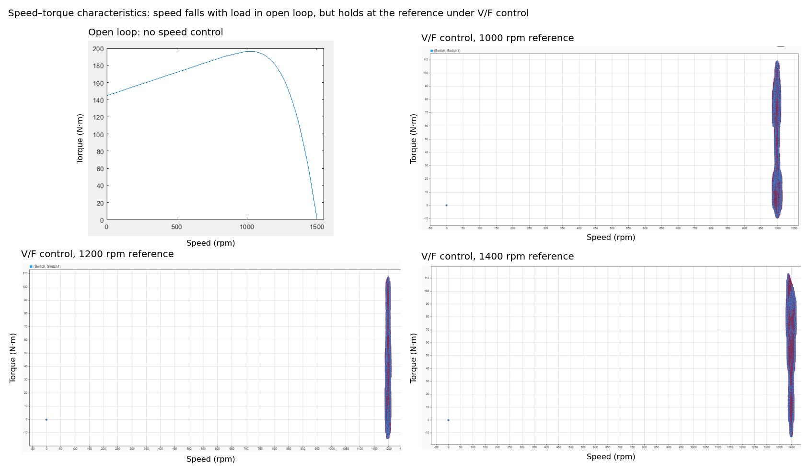
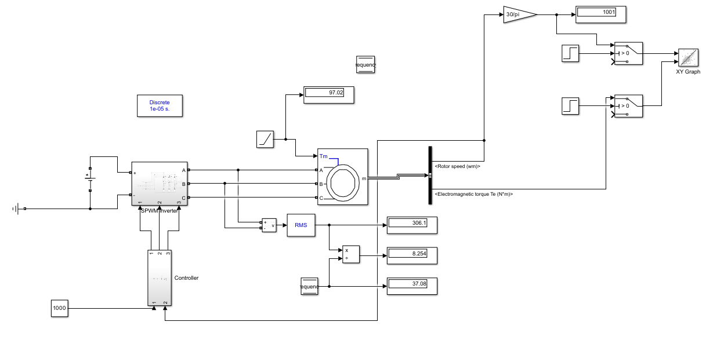

# Closed-Loop V/F Speed Control of an Induction Motor (MATLAB/Simulink)

A Simulink model of a three-phase squirrel-cage induction motor, driven by a **six-IGBT SPWM inverter** under **closed-loop V/F (scalar) control** with a PI speed regulator. I first characterised the motor's open-loop speed–torque curve with a MATLAB script, then designed the controller to hold speed at its reference from no load to full load while keeping the voltage-to-frequency ratio constant.

*University of Salford, BEng Electrical and Electronic Engineering, Machines and Drives, February 2025.*



## Results

| Speed reference | Speed from no load to full load | Measured V/F ratio | Deviation from 8 V/Hz |
|---|---|---|---|
| 1000 rpm | held at reference | 8.25 V/Hz | +3.2% |
| 1200 rpm | held at reference | 8.32 V/Hz | +4.0% |
| 1400 rpm | held at reference | 7.90 V/Hz | −1.3% |

The design value is the motor's rated 400 V / 50 Hz = **8 V/Hz**. All three operating points stayed within about 4% of it. Without control, speed falls steadily as load increases (top-left plot). Under V/F control, speed stays locked to the reference across the whole load ramp, and the width of each trace is the PWM ripple.

## Step 1: Characterising the motor (open loop)

The motor was run directly from a 400 V, 50 Hz three-phase supply ([`inductionmotor.slx`](simulink/inductionmotor.slx)). A MATLAB script ([`speedtorquechar.m`](simulink/speedtorquechar.m)) stepped the load torque from 0 to 210 N·m while the simulation ran, recording speed and torque at each step to build the speed–torque curve.

From the curve:
- Starting torque is about 145 N·m.
- Breakdown torque is about 196 N·m, at about 1000 rpm.
- The estimated rated point is about 97 N·m at about 1400 rpm.

This set the controller's operating range at **1000–1400 rpm**.

**Motor parameters:** squirrel cage, 18.45 kVA, 400 V (line-line), 50 Hz, 2 pole pairs (synchronous speed 1500 rpm), Rs = 0.5968 Ω, Rr = 0.6258 Ω, Lm = 35.4 mH, J = 0.05 kg·m².

## Step 2: V/F control system



**Controller** ([diagram](docs/controller.png)):
1. Speed error = reference − measured speed (rpm).
2. A discrete PI controller (Kp = 1, Ki = 10, Ts = 10 µs) produces a slip-speed correction, which is added to the measured speed.
3. That speed is converted to a frequency, f = n·P/120 (P = 4 poles), and limited to 0–50 Hz.
4. The voltage amplitude is set proportional to frequency (f/50), which keeps V/f constant and so keeps the air-gap flux roughly constant.
5. Integrating 2πf gives the electrical angle, which generates three sine references 120° apart.

**SPWM inverter** ([diagram](docs/spwm_inverter.png)): the three references are compared with a 2.5 kHz triangular carrier. The comparator outputs and their complements drive the six IGBTs in three legs. A 653 V DC link supplies the inverter, sized as 2√2/√3 × 400 V so the inverter can deliver the full rated line voltage.

**Test sequence:** the motor starts at no load, then the load torque ramps from 2 s at 10.78 N·m/s, reaching full load by the 11 s end of the simulation. Solver: ode3, fixed step 10 µs.

## Running it

Requires MATLAB R2024a or later, Simulink and Simscape Electrical.
- Open [`simulink/vf_control.slx`](simulink/vf_control.slx), set the reference speed in the constant block, and run.
- To regenerate the open-loop curve, run [`speedtorquechar.m`](simulink/speedtorquechar.m) from the `simulink/` folder.

## Code review notes (2026)

- The speed–torque script originally referenced an undefined variable (`ex`). It's now defined, so the script runs.
- The script pauses and resumes a live simulation using wall-clock delays, so its results depend on the speed of the computer. A more robust approach would be a single run with a slow torque ramp, or separate steady-state runs with `sim()`.
- **Next steps I'd explore:** low-speed voltage boost (V/f control struggles at low frequency, where stator resistance drop dominates), a comparison with open-loop V/f, and field-oriented control for better dynamic response.

## Repository contents

```
simulink/   Open-loop motor model, V/F control model and speed–torque script
docs/       Model diagrams and results plots
```
